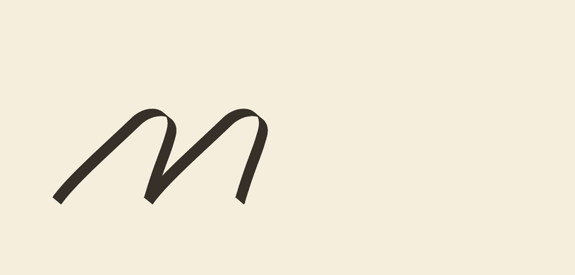

# CURRICULUM-014 — baseline/x-height-compatible assembly

**Next-stage evidence:** [HANDVALIDATE-020 independent validation and owner review](../validation/index.html).
Its bounded mechanical checks pass; human appearance approval remains pending.

This opt-in construction removes the earlier `m` staircase. It does **not**
learn context, words, fatigue or a historical hand. The strokes retain their
slanted shape; level endpoints alone do not establish a satisfactory letterform.

## Samples

- [Actual n](run-001/seed-7/first/repeat-n-actual.png),
  [actual u](run-001/seed-7/first/repeat-u-actual.png),
  [actual m](run-001/seed-7/first/repeat-m-actual.png).
- [Before / target / nominal / desired / actual workbook](run-001/seed-7/first/workbook.png),
  [seed 19](run-001/seed-19/first/workbook.png),
  [seed 41](run-001/seed-41/first/workbook.png). Native **900 DPI**, equal physical
  scale and full comparison frame; click through before judging pixelation.
- [Numbered shared-stroke construction with level guides](construction-full-frame.svg).
  This presentation copy changes only the original SVG viewport/background to expose the
  rotated underturn's left overhang. Paths are unchanged. It is not ink evidence;
  the original diagram remains in the immutable bundle.
- [Candidate](run-001/seed-7/first/candidate.json),
  [derived transforms](run-001/seed-7/first/evaluation-freeze.json),
  [shared-primitive propagation proof](run-001/seed-7/first/reuse.json).
- [Earlier translation-only experiment](../README.md) remains unchanged.



## Construction contract

The pinned primitive and action bytes do not change. Each return's endpoint
chord determines a shared **-18.434949 degree** whole-gesture rotation. Exact
cubic extrema determine uniform scales **0.9546734** (underturn) and **0.9710506**
(overturn), then translation puts centerline extrema at baseline 0 and x-height 1.
All occurrences reuse the same transform. No optimizer, independent per-letter
curves, target-pixel fit, anisotropic warp or extra reference is introduced.

| Construction | Composition | Expanded references |
|---|---|---:|
| n | unchanged standalone stem, lift, level overturn | 4 |
| u | level underturn, lift, unchanged standalone stem | 4 |
| m | level overturn, lift, same level overturn | 6 |

The unchanged standalone stem is now independently admitted by
[HANDVALIDATE-019](../../foundation_repair/stem_evaluation/README.md) within its
synthetic unit-scale, zero-rotation fixed-tool scope. This runner consumes its
literal report hash and still measures every newly placed occurrence. Rotated
returns are **not** independently admitted by the old unrotated return reader.

The new target version, `independently-chord-levelled-analytic-families-v1`,
normalizes each unchanged analytic target family's **own points**. It never
inspects the candidate cubics or candidate transform. All old targets and
results remain byte-identical. Image limits remain **0.05 absolute / 0.75
relative-to-prior**. New level gates are 1e-8 x-height nominal residual and the
existing 0.05 mm physical endpoint tolerance applied to actual centerline extrema.
Centerlines, not finite-width nib edges, define the level measurements.

The new common frame is **[-3,20,2,13] mm**. Pre-render tests found the rotated
underturn would overhang the old left edge. Every initial/target/nominal/desired/
actual panel uses the same widened frame, with footprint containment checks.
Local windows include the overhang and can overlap a neighboring letter; they
are contextual image windows, not isolated owner masks.

Nine fixtures cover isolated n/u/m, prior-pair regressions `nu/um/mn`, and genuinely
new `un/mu/nm` juxtaposition probes. Advance widths and letter spacing are unchanged.
Pairs are not learned words or joining rules. Actual execution uses base, finer
arc and finer time steps with exact ownership, contact-boundary, tool and
convergence checks. No new source-subdivision or S2 admission is claimed.

## Frozen evidence and numeric correction

[Specification](spec-v1.json) and execution code `350dfc6` were frozen before
rendering. Each seed (7/19/41) receives first/replay processes, cumulative ceilings
of 5000 renders and 1800 seconds, and zero retries or optimization evaluations.

The original decision checker has a serialization defect: it explicitly accepts
Python `float` but rejects the finite `numpy.float64` ratio produced by image
loss division. JSON saving preserves the number but restores it as a Python
float. Thus all six **worker receipts say false**, while the root decision,
computed after JSON reload, says **pass**. Both are preserved byte-for-byte;
neither is silently rewritten. The ordinary strict reader rejects this mismatch.
This is a software decision defect, not evidence of failed geometry.

The separate `letter_alignment_evidence` reader verifies the pinned report,
complete manifest, live admitted source, code freeze, all seeds/replays,
budgets, lineage and actual trace proofs. It reconstructs the original NumPy
type failure, then explicitly normalizes finite numeric ratios and reapplies
**all unchanged gates**. Invalid numbers, booleans, missing evidence and failed
physical/image limits still fail. No rerendering, fitting or new candidate occurs.
It verifies the raw worker failures and the root's post-serialization numeric
decision separately. The adjudication is separate from the preserved receipts.

Even a numeric assembly pass keeps **S2, real-hand and context-training acceptance
false**. Independent evaluation of the newly rotated occurrences and human
appearance/reading review are the next gates, not context or fatigue.

## Reproduce safely

```sh
.venv/bin/python -m pytest tests/test_letter_alignment.py tests/test_letter_alignment_evidence.py -q
```

The experiment CLI `python -m scribesim.curriculum.letter_alignment` refuses to
overwrite `run-001` or start an automatic retry. Preserve the original protocol,
including its diagnosed checker defect; use the separate read-only reader for
numeric adjudication. Do not modify the frozen runtime to make old evidence pass.

## Results

All three seeds and first/replay workers satisfy every unchanged numeric gate.
Nominal level/attachment residual is at most **2.49e-16 x-height**; actual
centerline-extrema residual is at most **0.00010830 mm**, below 0.05 mm.
Worst global actual/target loss is **0.025637**; worst local is **0.026245**;
worst local nominal loss is **0.026337**. All are below 0.05. The worst new/prior
nominal loss ratio is **0.037977**, below 0.75.

| Isolated construction | Worst local actual/target loss |
|---|---:|
| n | 0.0137832 |
| u | 0.0256367 |
| m | 0.0153163 |

**768 renders**, 256 per seed including replay; maximum cumulative seed time
**243.501 seconds**, below 1800. Each worker replays **69 non-clock artifacts**;
the complete manifest contains **422 artifacts**. There is no optimization,
rerender, revised candidate or automatic retry. Seeds repeat the same deterministic
construction, not three independently learned hands.

Source report SHA-256:
`bd9cf281cb28fbc5bb31dcdaf0646c3cf4b9d7a7d58edad19aa303d4ea11a34c`.
Read-only verification, with an explicit consumer pin:

```sh
.venv/bin/python -m scribesim.curriculum.letter_alignment_evidence --report-sha256 bd9cf281cb28fbc5bb31dcdaf0646c3cf4b9d7a7d58edad19aa303d4ea11a34c
```

See the [unchanged root report](run-001/report.json),
[cumulative ledger](run-001/execution.json) and [numeric adjudication](adjudication.json).
Local replay/tests are not provider CI, historical legibility or owner approval.

Validation: **112 broader tests pass** (56.64 seconds); **31 new-module tests
pass in a clean committed checkout** (4.39 seconds). Plan, generated rules,
whitespace, sample links and unchanged diagram paths pass. The workbook and
padded SVG were visually inspected. Strict PR metadata checking retains the
installed `ADV-SS-*` parser limitation; unrelated existing schema warnings remain.
